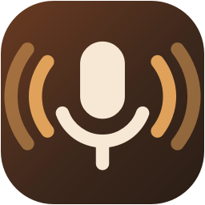
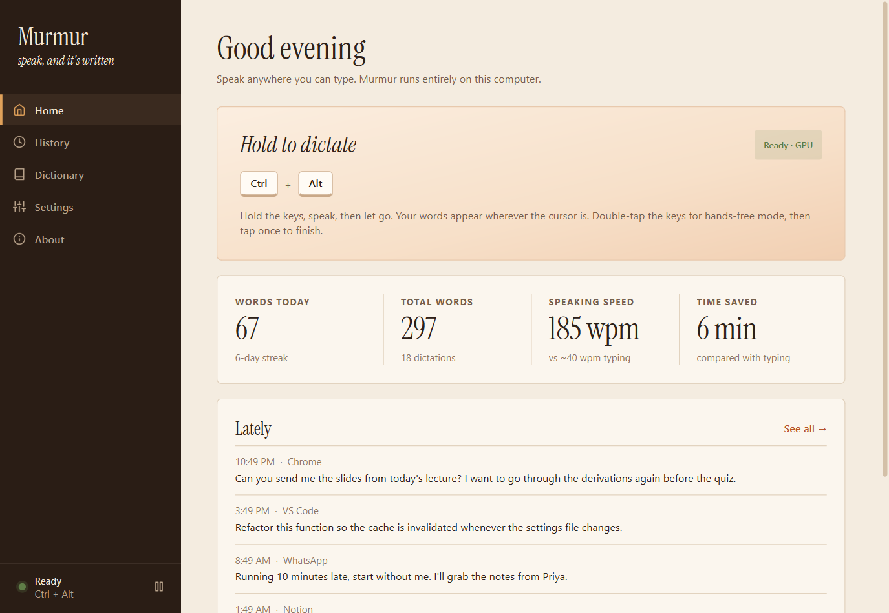
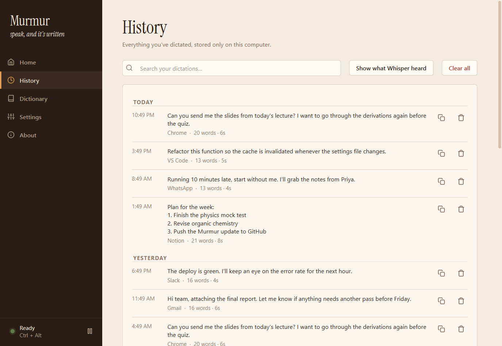
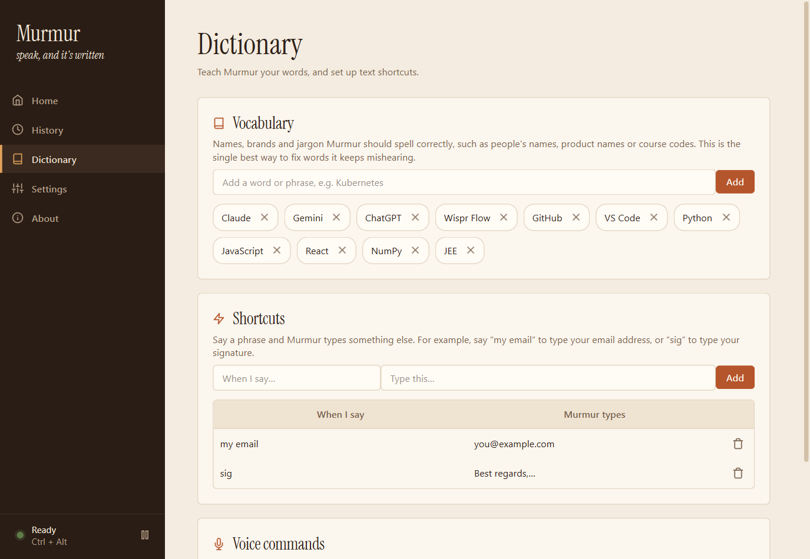
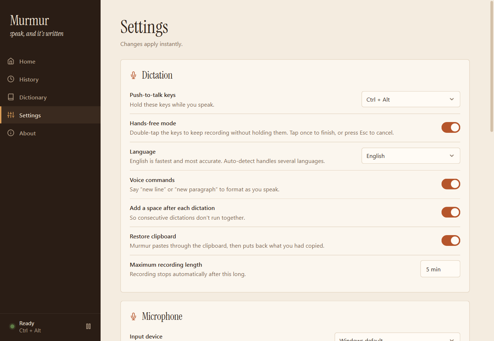

<p align="center">
  
</p>

<h1 align="center">Murmur</h1>

<p align="center">
  <b>Free, offline voice dictation for Windows.</b><br>
  Hold a hotkey, speak, let go. Your words appear wherever you can type.<br>
  No account, no subscription, no word limits. Your voice never leaves your computer.
</p>

<p align="center">
  <a href="https://github.com/Abhijay-Nagal/murmur/releases/latest/download/Murmur.zip"><b>⬇ Download Murmur for Windows</b></a>
  &nbsp;·&nbsp;
  <a href="#install-in-3-steps">Install guide</a>
  &nbsp;·&nbsp;
  <a href="#will-it-run-on-my-pc">Will it run on my PC?</a>
  &nbsp;·&nbsp;
  <a href="#help">Help</a>
</p>

<p align="center">
  
</p>

## What it does

Murmur is a free alternative to paid dictation apps like Wispr Flow. It uses OpenAI's open-source **Whisper** speech model, running on your own computer, so it is accurate, fast, and private.

- **Works in every app.** Chrome, Word, VS Code, WhatsApp, Slack, Notion: if you can type there, you can talk there.
- **Hold to talk, or go hands-free.** Hold `Ctrl + Alt` while you speak. Or double-tap it to keep listening without holding.
- **AI cleanup (optional).** Removes "um"s, understands "Tuesday, no wait, Wednesday", and formats spoken lists. It also runs on your computer.
- **Learns your words.** Add names, brands, and jargon so they're always spelled right.
- **Shortcuts.** Say "my email" and Murmur types your address.
- **Voice commands.** Say "new line" or "new paragraph" as you speak.
- **History and stats.** Search everything you've dictated, and see your words per minute and time saved.

<p align="center">
  
  <br><sub>A small bar at the bottom of the screen shows when Murmur is listening.</sub>
</p>

## Install in 3 steps

1. **[Download Murmur.zip](https://github.com/Abhijay-Nagal/murmur/releases/latest/download/Murmur.zip)** from the latest release.
2. **Extract it.** Right-click the zip → **Extract All…** Put the folder somewhere permanent, such as `Documents\Murmur`.
3. **Double-click `install.bat`** in that folder and wait. It takes 5 to 15 minutes the first time.

The installer handles everything:

- It installs Python if you don't have it.
- It checks whether your PC has an NVIDIA graphics card and sets Murmur up to match.
- It downloads the speech model and adds Murmur to your desktop and Start Menu.

When it finishes, Murmur opens. Click into any text box, **hold `Ctrl + Alt`, speak, and let go.**

> **"Windows protected your PC"?** That warning appears for any file downloaded from the internet that isn't from a big publisher. Click **More info → Run anyway**. Murmur is open source, so you can read every line of the code here.

## Will it run on my PC?

| | Minimum | Best experience |
|---|---|---|
| **System** | Windows 10 or 11 (64-bit) | Windows 11 |
| **Graphics** | None needed (runs on the processor) | NVIDIA GPU with 4 GB+ of video memory |
| **Memory (RAM)** | 8 GB | 16 GB |
| **Free disk space** | 2 GB | 5 GB (7 GB with AI cleanup) |
| **Internet** | Only during install | Only during install |
| **Microphone** | Any built-in or headset mic | A headset mic |

### What you get on your hardware

| Your PC has… | What Murmur uses | Speed |
|---|---|---|
| **NVIDIA GPU, 6 GB or more** (RTX 3060, 4060, etc.) | Turbo model on the GPU, plus AI cleanup | Under 1 second |
| **NVIDIA GPU, 4 GB** (GTX 1650, RTX 3050, etc.) | Turbo model on the GPU. Turn AI cleanup on only if it stays fast | About 1 second |
| **NVIDIA GPU, 2–3 GB** | Pick **Small** in Settings → Speech model | About 1 second |
| **AMD or Intel graphics, or no separate GPU** | Small model on the processor (set up automatically) | 1–3 seconds |
| **Mac or Linux** | Not supported yet. Murmur is Windows-only for now | n/a |

**No NVIDIA card?** Murmur still works well. The installer notices and sets up the **Small** English model on your processor, which is lighter and quick on any recent laptop. Other options:

- **Want better accuracy on a fast processor?** In **Settings → Speech model**, choose **Turbo**. It's more accurate but takes a few seconds per sentence.
- **Speaking a language other than English?** The Small model is English-only. Choose **Turbo** and set the language in **Settings → Language**.
- **AI cleanup without a GPU** runs on the processor too, but it adds a few seconds per dictation. Murmur works fine with it switched off.

## Using Murmur

| To… | Do this |
|---|---|
| Dictate | Hold **Ctrl + Alt** while you speak, then let go |
| Dictate hands-free | Double-tap **Ctrl + Alt**. Tap once to finish, or press **Esc** to cancel |
| Start a new line | Say "new line" or "new paragraph" |
| Change the hotkey | **Settings → Push-to-talk keys** |
| Pause Murmur | The pause button at the bottom of the sidebar, or the tray icon |

Closing the window keeps Murmur running in the system tray (the small icons near the clock). To exit completely, right-click the tray icon → **Quit Murmur**. To launch it automatically when your PC starts, turn on **Settings → Start with Windows**.

### Optional: AI cleanup

1. Install **[Ollama](https://ollama.com/download)**. It's free and runs AI models on your own computer.
2. In Murmur, open **Settings → AI cleanup** and click **Download model** (about 2 GB, one time).
3. Pick a style: **Light** (just tidies up), **Polished** (also fixes grammar), or **Casual** (for chats).

<table>
  <tr>
    <td></td>
    <td></td>
    <td></td>
  </tr>
  <tr align="center"><td>History</td><td>Dictionary</td><td>Settings</td></tr>
</table>

## Help

<details>
<summary><b>Nothing gets typed in one particular app</b></summary>

If that app is running as administrator, Windows blocks normal apps from typing into it. Either run that app normally, or right-click the Murmur shortcut → **Run as administrator**.
</details>

<details>
<summary><b>Murmur doesn't hear me</b></summary>

Open Windows **Settings → Privacy & security → Microphone** and turn on **Let desktop apps access your microphone**. Then, in Murmur, go to **Settings → Microphone**, pick your mic, and watch the level meter move as you speak.
</details>

<details>
<summary><b>It says "CPU" but I have an NVIDIA card</b></summary>

Update your NVIDIA driver from <a href="https://www.nvidia.com/Download/index.aspx">nvidia.com</a> or the NVIDIA App, then run <code>install.bat</code> again. It adds the GPU libraries once it can see your card.
</details>

<details>
<summary><b>It's slow</b></summary>

On a PC without an NVIDIA GPU, choose **Settings → Speech model → Small** and turn off AI cleanup. The first dictation after starting is always a little slower while the model warms up.
</details>

<details>
<summary><b>My antivirus warned me</b></summary>

Murmur listens for your hotkey with a keyboard hook. Some antivirus programs flag that pattern even though it is only waiting for the hotkey. Murmur never records keystrokes or sends anything online. The full source is in this repository.
</details>

<details>
<summary><b>The hotkey clashes with another app</b></summary>

Pick a different combination in **Settings → Push-to-talk keys**, for example **Right Ctrl**.
</details>

<details>
<summary><b>Install failed</b></summary>

Check your internet connection and free disk space, then run <code>install.bat</code> again. It continues from where it stopped. If it still fails, <a href="https://github.com/Abhijay-Nagal/murmur/issues/new?template=bug_report.md">open an issue</a> and paste the error text from the window.
</details>

Still stuck? **[Open an issue](https://github.com/Abhijay-Nagal/murmur/issues)**. Please include your Windows version, your graphics card, and the log file at `%APPDATA%\Murmur\murmur.log`.

## Updating

Download the new `Murmur.zip`, extract it over your old Murmur folder, and run `install.bat` again. Your history, words, and settings are kept. They live separately in `%APPDATA%\Murmur`.

## Uninstalling

Quit Murmur from the tray, then double-click **`uninstall.bat`**. It removes the shortcuts and the app's files, and asks whether to delete your history and the downloaded speech models too. Then delete the Murmur folder.

## Privacy

- Speech recognition and AI cleanup both run on your computer.
- No account, no analytics, no telemetry. Murmur makes no network requests except to download models during setup.
- Your history is stored only in `%APPDATA%\Murmur\history.db`. You can switch it off in **Settings**.

---

## For developers

```
hotkey ─► mic (always-open stream, 300 ms pre-roll so the first word is never clipped)
       ─► Silero VAD: trims only leading/trailing silence and rejects empty clips
       ─► faster-whisper (CUDA fp16, or CPU int8) with a vocabulary prompt
       ─► voice commands ─► Ollama cleanup (optional) ─► shortcuts
       ─► clipboard + Ctrl+V into the focused app, then your old clipboard is restored
```

| Path | Role |
|---|---|
| `murmur/engine/controller.py` | Pipeline and state machine. One worker thread, Qt signals to the UI |
| `murmur/engine/hotkey.py` | Hold, double-tap and cancel detection for modifier-only hotkeys |
| `murmur/engine/transcriber.py` | Whisper loading (CUDA with CPU fallback) and transcription |
| `murmur/engine/cleanup.py` | Ollama cleanup, styles, status and model download |
| `murmur/ui/` | PySide6 interface: pages, overlay, theme and icons |
| `murmur/storage.py` | SQLite history and stats |

```bat
install.bat                                           :: sets up .venv as above
.venv\Scripts\pip install -r requirements-dev.txt
.venv\Scripts\python -m pytest
.venv\Scripts\python tools\screenshots.py             :: re-render docs/screenshots with sample data
.venv\Scripts\python tools\make_icon.py               :: regenerate assets/murmur.ico
debug.bat                                             :: run with a console for live logs
```

`requirements.txt` holds the core libraries; `requirements-gpu.txt` adds the NVIDIA CUDA libraries, so no separate CUDA install is needed.

Contributions are welcome. Open an issue first for larger changes.

## License

MIT © Abhijay Nagal. Built on [faster-whisper](https://github.com/SYSTRAN/faster-whisper), [OpenAI Whisper](https://github.com/openai/whisper), [Silero VAD](https://github.com/snakers4/silero-vad), [Ollama](https://ollama.com) and [Qt for Python](https://doc.qt.io/qtforpython/). Headings use [Instrument Serif](https://github.com/Instrument/instrument-serif) (SIL Open Font License).
